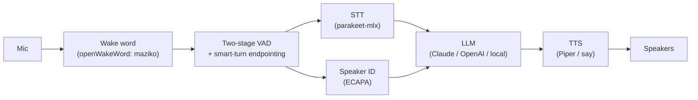

<div align="center">

<a id="top" name="top"></a>

<picture>
  <source media="(prefers-color-scheme: dark)" srcset="docs/assets/hero-dark.svg">
  <source media="(prefers-color-scheme: light)" srcset="docs/assets/hero-light.svg">
  
</picture>

<br>

<a href="#-get-started"></a>

<br>

A private voice assistant that lives on your own machine — say a word, ask out loud, and hear a natural reply.

<br>

[](LICENSE)
[](pyproject.toml)
[](#-quick-start)
[](#-quick-start)
[](#-your-audio-never-leaves-your-mac)
[](https://github.com/astral-sh/ruff)
[](#-quick-start)

<br>

**🚀 [Get started](#-get-started) · 🎙️ [What it does](#what-it-does) · ⚡ [Quick start](#-quick-start) · 🔁 [How it works](#how-it-works) · 🤖 [Claude bridge](#-claude-bridge-voice-control-of-claude-sessions-and-the-mac) · 🔒 [Privacy](#-your-audio-never-leaves-your-mac) · 🛠️ [Developers](#for-developers)**

</div>

<br>

<div align="center">

The pipeline, live — wake word → speech-to-text → LLM → speech, all on one Mac:



### 🖥️ [See the control room →](https://glensk.github.io/my-stt-tts/gui.html) &nbsp;·&nbsp; 🔊 [Hear the voices →](https://glensk.github.io/my-stt-tts/)

<!-- DEMO VIDEO: record ~20-40s of `./mstt --wake --barge-in always --browser`,
     drag the file into a GitHub issue/PR comment to get a https://github.com/user-attachments/... URL,
     then paste that bare URL on its own line right here — GitHub mounts a native <video> player. -->

</div>


## 🚀 Get started

**New here? Onboarding is one command (below). First, here's how it looks:**

### 👀 How it looks

**[Open the interface preview →](https://glensk.github.io/my-stt-tts/gui.html)** — a zero-install,
scripted preview of the control room (not a live LLM). To actually talk to it, run the one command below.

### ⌨️ Run it for real (one command)

Talking to a **real LLM in seconds** — no microphone and no API key:

```bash
git clone https://github.com/glensk/my-stt-tts && cd my-stt-tts && ./quickstart.sh
```

`quickstart.sh` runs `uv sync --extra all`, **auto-detects a key-free brain** (the Claude CLI, a
local Ollama model, or Codex), then opens the **browser control room in typed mode** and prints +
opens the link — so you're typing to a live LLM right away, no API key.

> **Next:** once the control room is open, use the **Settings** panel to switch the
> **brain/model, voice, and language (DE / FR / EN)** and set your **location + units** (defaults:
> Lausanne, Switzerland / metric). Then click the mic 🎙️ (or press **Space**) to talk out loud.
>
> *Full local stack is a working prototype on **macOS Apple Silicon**. Deeper install options,
> voices, and flags live in **[🚀 Quick start](#-quick-start)** below.*

<div align="right"><a href="#top">↑ back to top</a></div>


## What it does

- 🗣️ Talk to it hands-free — just say the wake word, no buttons.
- 💬 It replies out loud in a natural voice — a real back-and-forth, not beeps.
- 🌍 Understands and speaks **German, French, and English**.
- ✋ Interrupt it any time — start talking and it stops to listen.
- 👥 Knows who's speaking and can greet each person by name.
- 🛠️ Actually *does* things — checks the time, does the math, controls your home — not just chat.
- 💻 Use it from your laptop, another room, or your web browser.
- 🔒 Your voice never leaves your Mac — only the words you say reach the AI.
- 🧠 Pick your own brain — Claude by default (no API key needed), or OpenAI, or a fully local model.
- 🎙️ Choose your voice — calm, warm, male, female, per language.

---

## Meet your assistant

It is the assistant you wish the smart speaker on your shelf actually was: **always local, always
yours, and genuinely conversational.** You speak; it listens; it answers in a real voice — and if you
change your mind mid-sentence, you just talk over it and it stops to hear you out.

It runs entirely on a **MacBook with Apple Silicon**. The microphone audio is processed on the machine
itself; only the *words* you say are sent to the AI brain you choose. That brain is **Claude by
default — and it works with no API key at all** thanks to a bundled command-line login — or you can
point it at OpenAI, a local model, or anything in between.

> **Status — working prototype.** Everything below is built and tested today on macOS Apple Silicon.
> It runs from source; one-click installers are on the roadmap. Full design and roadmap live in
> **[`PLAN.md`](PLAN.md)**.

---

## What you can do with it

Each capability below is real and shipping. Open **Technical details** under any one for the
specifics — models, flags, and how it works under the hood.

### 🗣️ Talk to it hands-free

Say **"maziko"** and start talking. No buttons, no app to open — it is always listening for its name
and ignores everything else.

<details>
<summary>Technical details</summary>

<br>

On-device wake-word detection via **openWakeWord** with a custom-trained **"maziko"** phrase
(`wakewords/maziko.onnx`). Enable hands-free mode with `--wake`; without it you get a simple
push-to-talk or typed loop. The detector runs locally on raw mic frames — nothing is streamed
anywhere to listen for the wake word.

</details>

### 💬 It answers out loud, naturally

You ask a question by voice and hear a spoken answer in a calm, natural voice — a real conversation,
not a list of beeps.

<details>
<summary>Technical details</summary>

<br>

Speech-to-text runs locally with **`parakeet-mlx`** (MLX-native, sub-second on Apple Silicon) and
streams **partial transcripts as you speak** (`--stt-streaming`) so the reply starts sooner. The
reply is spoken by **Piper** neural voices (German, French, and English) with a built-in macOS `say`
fallback that needs zero install. Short **chimes** mark the start and end of listening — language-
neutral and far faster than spoken stage-cues. An optional cloud voice backend can be enabled for a
higher-quality voice when a key is present; it stays **local-first** and falls back to on-device
otherwise.

</details>

### ✋ Interrupt it any time

It is still listening while it talks. Start speaking and it stops mid-sentence to hear you — even
out loud on open speakers, not just with headphones.

<details>
<summary>Technical details</summary>

<br>

Full-duplex **barge-in** (`--barge-in off|headphones|always`): the mic stays live during playback,
and confirmed speech cancels both the spoken output **and** the in-flight LLM response. **Acoustic
echo cancellation** (`--aec off|nlms|voiceprocessing|auto`) removes the assistant's own voice from
the mic — either via macOS hardware `VoiceProcessingIO` or a pure-numpy NLMS adaptive filter — so
barge-in works on open speakers. A **false-interrupt gate plus an acoustic interruption predictor**
keep it from cutting itself off on stray noise, and **post-interruption context repair** trims the
conversation history to only what was actually spoken aloud, so the assistant never thinks it said
something you cut off.

</details>

### 🎯 It knows when you're done talking

It waits for you to actually finish a thought instead of cutting you off on a half-second pause.

<details>
<summary>Technical details</summary>

<br>

Turn-taking is handled by a two-stage voice-activity detector feeding **Smart Turn v3** prosodic
end-of-turn detection, which is the **default** (`--turn-analyzer smart`). The model auto-downloads
on first run and gracefully falls back to a plain silence timer (`--turn-analyzer silence`) if the
model or runtime is unavailable.

</details>

### 👥 It knows who's speaking

It can tell household members apart by voice and greet each person by name.

<details>
<summary>Technical details</summary>

<br>

Speaker identification via **SpeechBrain ECAPA-TDNN** embeddings with per-person voice enrollment and
cosine matching (with a rejection margin for unknown voices). It runs **in parallel** with
speech-to-text, so it adds effectively zero latency. Enrollment profiles are stored locally and
git-ignored.

</details>

### 🛠️ It does things, not just chat

Ask the time, ask it to do some math, or ask it to control your home — it carries out the action and
tells you the result, all in one spoken turn.

<details>
<summary>Technical details</summary>

<br>

In-conversation **function / tool calling** (`tools.py`): the model emits a tool call mid-reply, the
loop runs it, feeds the result back, and keeps streaming the spoken answer. Both the **Anthropic and
OpenAI** tool-use round-trips are implemented. Shipped example tools: `get_time`, a safe
`calculator`, and `home_control` (routes to a Home Assistant dispatch). Toggle with `TOOLS_ENABLED`.

</details>

### 💻 Use it from anywhere in the house

Run it on your laptop, stream it to another room, or watch and talk to it right in your web browser.

<details>
<summary>Technical details</summary>

<br>

A pluggable **audio transport** seam lets the same pipeline source mic audio and play replies
**over the network** (`--transport local|websocket`), so one Mac can serve a whole-house satellite
(`python -m my_stt_tts.satellite ws://<host>:<port>`) while the heavy STT/LLM/TTS stays in one place.
The **browser control room** (`--browser`, with `--browser-audio` for real mic capture via
`getUserMedia`) streams 16 kHz PCM over a same-origin WebSocket and plays the reply back — live
state, transcript, and audio in the page. The WebSocket framing is hand-rolled on Python's stdlib
(`ws_frame.py`), so the GUI carries **zero runtime web dependencies**.

</details>

### 🧠 Bring your own brain

Claude runs it out of the box with **no API key required**. Prefer OpenAI, a local model, or
something self-hosted? Point it there in one line.

<details>
<summary>Technical details</summary>

<br>

The brain is **provider-agnostic** over an OpenAI-compatible interface. Select it in `.env`
(see [`.env.example`](.env.example)):

| Variable         | Example                     | Meaning                                                                |
| :--------------- | :-------------------------- | :--------------------------------------------------------------------- |
| `LLM_PROVIDER`   | `anthropic`                 | `anthropic` / `openai` / `openai-compatible` / `ollama` / `claude-cli` |
| `LLM_MODEL`      | `claude-haiku-4-5`          | fast-path model id                                                     |
| `LLM_MODEL_DEEP` | `claude-opus-4-8`           | optional "deep" model                                                  |
| `LLM_BASE_URL`   | `http://localhost:11434/v1` | for OpenAI-compatible / local servers                                  |

The **`claude-cli`** brain shells out to a **stripped, isolated** Claude CLI — its own minimal
prompt, no tools, and no access to your global `~/.claude` config — so you get a no-API-cost,
session-keeping brain (`--brain haiku-sub`). The API path (`--brain haiku-api`) is faster to first
token if you have a key.

</details>

### ☁️ Or talk to an ElevenLabs agent

`./mac-voice` runs a cloud **ElevenLabs agent** (their speech-to-text, LLM and voice, configured in the
ElevenLabs dashboard) through this Mac's mic and speakers. Running it locally instead of in the
browser is what lets the agent later call local functions on this Mac.

<details>
<summary>Technical details</summary>

<br>

One-time: `uv sync --inexact --extra elevenlabs`, then put `ELEVENLABS_API_KEY` and
`ELEVENLABS_AGENT_ID` into `.env`. The SDK talks to the agent's **published** version, so publish
dashboard changes before testing them here.

| Command                     | Meaning                                                                           |
| :-------------------------- | :-------------------------------------------------------------------------------- |
| `./mac-voice`               | open speakers + macOS echo cancellation (FaceTime's) — talk over it any time      |
| `./mac-voice -m speakers`   | open speakers; mic muted while the agent talks (fallback, no interrupting)        |
| `./mac-voice -m headphones` | raw mic + plain playback, full duplex — headphones only                           |
| `./mac-voice -l`            | list audio devices; pick them with `-i` / `-o` (speakers/headphones modes)        |

Ctrl-C ends the conversation. Code: [`eleven_voice.py`](src/my_stt_tts/eleven_voice.py).

**LLM on the Claude API credits: `-B claude`.** By default the agent's own LLM runs and
ElevenLabs bills it in credits (about 40 % of a call's credits; the rest is the per-minute
voice part). `-B claude` (or `MAC_VOICE_LLM_BACKEND=claude` in `.env`, so the LaunchAgent
picks it up) moves only the LLM to Albert's private Console org and its monthly API
credits; speech-to-text, the voice and turn-taking stay on ElevenLabs, because the
Anthropic API has neither speech-to-text nor text-to-speech. It works through ElevenLabs'
custom LLM: their servers call Anthropic's OpenAI-compatible endpoint
`https://api.anthropic.com/v1`. ElevenLabs accepts a custom LLM only on an agent whose LLM
is `custom-llm`, so the backend runs a **twin agent** — a copy of the main agent
(prompt, tools, voice, overrides) — that every `-B claude` start re-syncs from the main
agent. Model: `MAC_VOICE_CLAUDE_MODEL`, default `claude-haiku-5-5` (lowest time to first
token and USD 0.10 / 0.50 per million tokens; the compatibility layer cannot lower thinking
effort, which would make Sonnet slower).

| Command                       | Meaning                                                                             |
| :---------------------------- | :---------------------------------------------------------------------------------- |
| `./mac-voice -C`              | one-time setup: key → ElevenLabs workspace secret, create + sync the twin agent     |
| `./mac-voice -B claude`       | one conversation with the LLM on the Claude API                                     |
| `./mac-voice -d -B claude`    | the daemon with the LLM on the Claude API                                           |
| `./mac-voice -B elevenlabs`   | force the agent's own LLM (overrides `MAC_VOICE_LLM_BACKEND`)                       |

`-C` reads the key from the Vaultwarden item `anthropic-api-private-elevenlabs` through `secret-run`
(never printed; a private-org Console key used only by ElevenLabs, so it can be revoked on
its own), checks it with one tiny request, stores it as the ElevenLabs workspace
secret `anthropic-api-private-elevenlabs` (ElevenLabs must hold it to call Anthropic) and records the
twin's id in `~/.local/state/mac-voice/claude-agent.json` (or set `ELEVENLABS_CLAUDE_AGENT_ID`).
Without that setup `-B claude` stops with an ❌ that says so. After a new key, run `-C` again.
The models line of each conversation then reads `LLM claude-haiku-5-5 via Claude API credits`,
and the cost line's `LLM $` is what ElevenLabs no longer bills. Code:
[`claude_llm.py`](src/my_stt_tts/claude_llm.py).

**Hands-free: the daemon.** `./mac-voice -d` (or `-I` to install it as a login LaunchAgent)
owns the mic: while idle it listens for "voice on" (custom phrase via sherpa KWS,
`MAC_VOICE_WAKE`) or "hey jarvis" (openWakeWord, threshold `MAC_VOICE_WAKE_THRESHOLD`=0.75);
on the wake word, on `./mac-voice -t` (Karabiner: hold `v`, tap `o`, any app) or from the
SwiftBar item it says "voice on" and connects; the same toggle, saying "voice off" (the
agent hangs up), 60 s of silence or 15 min end it with "voice off". Every console line
carries a HH:MM:SS timestamp; each conversation logs its models at the start and, a few
seconds after it ends, the $ LLM price of every agent sentence, the call's credits and $
(voice vs LLM) and the billing period's credits so far ([`eleven_costs.py`](src/my_stt_tts/eleven_costs.py)). `-n`/`-f` force on/off, `-w on|off` toggles the wake
word (remembered), `-s` prints the state. **Only enrolled voices start it**: record your
wake phrase with `scripts/enroll_wakeword.py "voice on" -n 8 -w NAME` (hands-free; it also
builds `enroll/NAME.npy`), or rebuild all profiles with `-V`; with no profiles anyone can. The menu-bar plugin is
[`swiftbar/mac-voice.5s.sh`](swiftbar/mac-voice.5s.sh) — symlink it into your SwiftBar
plugin folder. Code: [`voice_control.py`](src/my_stt_tts/voice_control.py).

</details>

<div align="right"><a href="#top">↑ back to top</a></div>


## 🚀 Quick start

Fastest path is **[🚀 Get started](#-get-started)** above (`./quickstart.sh`); this section is the
full set of flags, voices, and manual steps.

```bash
git clone https://github.com/glensk/my-stt-tts && cd my-stt-tts
uv sync --extra all                 # core + speech/voice/speaker/wake-word backends
uv tool install piper-tts           # neural voices for German / French / English
./mstt                              # start talking (push-to-talk; --debug shows cues)
```

No API key? The bundled Claude CLI needs none:

```bash
./mstt --brain haiku-sub --type     # type to it, hear it reply — zero API cost
```

The full natural-conversation experience — wake word, interrupt-any-time on open speakers, and
live partial transcripts:

```bash
./mstt --wake --barge-in always --aec auto --stt-streaming
```

<details>
<summary>More install options, voices, and the fine print</summary>

<br>

**Pick a voice.** List the bundled voices and choose one per language:

```bash
./mstt --list-voices
./mstt --voice amy                  # calm female (en); also ryan, kristin, lessac, thorsten (de), tom (fr)
```

**Lighter dev install** — pure logic and tests only, no machine-learning backends:

```bash
uv sync && uv run pytest
```

**Notes.**

- After `uv sync --extra all`, run the app with **`./mstt …`** (or `.venv/bin/my-stt-tts`). Avoid
  `uv run my-stt-tts` for daily use — it re-syncs and strips the optional extras.
- macOS `say` gives zero-install fallback voices, and the `sounddevice` wheel bundles PortAudio — no
  `brew install portaudio` needed. **uv-first**; Homebrew is only a fallback for anything without a wheel.
- Customize the spoken personality by editing `prompts/system_prompt.md`.
- Whole-house / browser audio needs the transport extra, included in `--extra all`. Run a satellite
  with `python -m my_stt_tts.satellite ws://<host>:<port>`.
- **Docker is not supported on macOS** for this app: containers there run in a Linux VM with no
  microphone or speaker access and no Apple-Silicon GPU (Metal / MLX) — no audio, no acceleration.
  Run it natively.
- Packaged installs (`uv tool install my-stt-tts`, a Homebrew tap) are planned.

</details>

<div align="right"><a href="#top">↑ back to top</a></div>


## 🤖 Claude bridge (voice control of Claude sessions and the Mac)

The `./mac-voice` daemon can do more than talk: with the bridge switched on, the ElevenLabs agent
gets **client tools** that run on this Mac. You can ask which Claude Code sessions are running,
hear what one of them needs, message it, answer its questions, and drive the Mac — open sites and
apps, control video, volume and brightness, or hand any other request to a Mac operator. Successes
stay quiet; problems are spoken. Design and acceptance record: `PLAN_claude-bridge.md` (local).

### What the bridge does

- **Claude Code sessions** (through the JSON commands of ccc, the claude-command-center,
  `ccc sessions | inspect | send | answer | delivery | events -j`):
  - `list_sessions` — a numbered list of the sessions of both Claude accounts by their memorable
    name, status (busy / idle / waiting / blocked) and short AIM; "number 2" works as a target
    afterwards. Background sessions (`claude --bg`) are marked and can only be listed and read.
  - `read_session` — the last reply or the last prompt of one session.
  - `brief_decision` — a spoken briefing of the decision a session waits for (a pending
    question picker, or a `You [decision]:` line in its to-do list): what the session works on,
    the question, the options and its recommendation with the reason.
  - `send_message` — types a message into the session's iTerm tab (idle: as a new prompt; busy:
    queued); `answer_decision` — answers its question picker (single and multi-select).
- **Mac fast path** (`mac_control.py`): `open_url` (any http(s) site in Safari; `youtube` and
  `jellyfin` shortcuts), `open_app` (any installed app), `set_volume`, `set_brightness` (built-in
  display), `media` (play, pause, seek ±s, next, previous, fullscreen, exit fullscreen on YouTube
  and Jellyfin) and `youtube_play_first`.
- **Mac operator** (`do_on_mac`): any other request ("close the other Safari tabs", "move
  delete-me.txt to the Trash") runs as a headless `claude -p` (model sonnet, billed to the work
  account) whose only tools come from a local broker (`mac_broker.py`: screenshots, UI trees,
  clicks, keys, typing, menus, Safari page reads, AppleScript). The broker checks every step
  against a risk table (below). One task runs at a time, one more may wait; a task ends with the
  call unless you said "do it even if I hang up"; hard limit 5 min.
- **Attention inbox** (`attention.py`): failed sends, a session that failed or asks a question
  after a voice message, failed Mac actions and operator tasks become problems in
  `~/.local/state/mac-voice/attention.db`. During a call they are spoken at once; otherwise the
  next "voice on" opens with a briefing of the open problems (≤ 600 characters), plus an optional
  content-free macOS banner. "Got it, \<subject\>" (voice-checked) clears one item; items expire
  after 7 days.
- **Spoken notices**: confirmation requests, late operator results ("done: …" / "Mac task failed:
  …") and new problems reach the call as `[system notice] …` messages, held up to 3 s while the
  agent is still speaking. A problem heard in the call is never briefed again at the next
  "voice on".

### Flags

Opt-in, in `.env` (read by `./mac-voice -d`); `ELEVENLABS_API_KEY` and `ELEVENLABS_AGENT_ID`
must be set as for `./mac-voice`.

| Variable                      | Example                             | Meaning                                                                       |
| :---------------------------- | :---------------------------------- | :---------------------------------------------------------------------------- |
| `MAC_VOICE_CLAUDE_BRIDGE`     | `1`                                 | the Claude session tools (list / read / brief / send / answer)                |
| `MAC_VOICE_MAC_CONTROL`       | `1`                                 | the Mac fast-path tools (disabled while a `-D` doctor check fails)            |
| `MAC_VOICE_OPERATOR`          | `1`                                 | the `do_on_mac` operator                                                      |
| `MAC_VOICE_DECIDE`            | `1`                                 | the decide hub tools (section "Decide hub by voice" below)              |
| `MAC_VOICE_AUTHORIZED`        | `albert`                            | the one voice profile that may act; unset → every bridge action is refused    |
| `MAC_VOICE_READY_SOUND`       | `/System/Library/Sounds/Glass.aiff` | played once the daemon listens (default Glass); `0`, `off` or empty: no sound |
| `MAC_VOICE_CCC_BIN`           | `~/.local/bin/ccc`                  | the ccc executable (default: `$PATH`, then `~/.local/bin/ccc`)                |
| `MAC_VOICE_STATE_DIR`         | `~/.local/state/mac-voice`          | daemon control socket + status (inbox, operator dirs stay in the default)     |
| `MAC_VOICE_SPEAKER_THRESHOLD` | `0.35`                              | wake-word voice gate only (the bridge's in-call check is fixed at 0.35)       |
| `MAC_VOICE_WAKE`              | `voice on`                          | custom wake phrase (sherpa KWS; "hey jarvis" stays active)                    |
| `MAC_VOICE_WAKE_THRESHOLD`    | `0.75`                              | openWakeWord threshold for "hey jarvis"                                       |
| `MAC_VOICE_WAKE_PHASES`       | `2`                                 | staggered openWakeWord copies while idle                                      |

Any of the first four flags also turns on the attention inbox and its monitor. Each component
gates itself, and a failing one never stops the others.

### Setup

```bash
uv sync --inexact --extra elevenlabs --extra operator    # mcp for the operator's broker
./mac-voice -D                                           # doctor: System Events + Safari automation,
                                                         # Safari "Allow JavaScript from Apple Events",
                                                         # Accessibility, volume read — ✅/❌ + fix
scripts/enroll_wakeword.py "voice on" -n 8 -w albert     # wake clips + wake profile enroll/albert.npy
scripts/enroll_call.py albert                            # call-domain profile enroll/call/albert.npy
scripts/eleven_agent_config.py -n                        # dry run: backup + diff of the agent config
scripts/eleven_agent_config.py -a                        # apply, verify, roll back on failure
./mac-voice -d                                           # the daemon, in an iTerm tab
```

- **Why a call profile.** In a call the mic runs through Apple's voice processing (echo
  cancellation, gain control), so in-call sentences score too low against the raw-mic wake
  profile (0.32 for Albert, under the 0.35 threshold). `enroll_call.py` records sentences through
  the same path a call uses (8 clips of 4 s, German / English / French hints), prints a
  leave-one-out calibration table and saves `enroll/call/<name>.npy`, which the in-call check
  prefers. Stop the daemon first: it owns the mic. `-n` records without writing.
- **Agent config.** `eleven_agent_config.py` manages the 23 client tools (by name, idempotent),
  `client_tool_call` events, the first-message override (the voice-on briefing), the soft-timeout
  filler (off) and a marked section of the system prompt. Every run writes a sanitised 0600 backup
  to `~/.local/state/mac-voice/agent-backups/`; `-a` rolls back by itself on any failure, and
  `-r <backup>` restores a backup by hand.

### Authorisation, as built now

Only the voice named by `MAC_VOICE_AUTHORIZED` may act. Each user transcript is bound to the
utterance it came from (Silero VAD segments of the call's mic stream, 5 s window), and the check
fails closed: no profile, a model failure, no or an ambiguous binding, or an utterance under
0.4 s is refused.

- **Two risk tiers.** The Mac fast-path tools (open a site or app, volume, brightness, media)
  need no voice match: one-word commands like "Play." score unreliably, and a call only starts
  after a voice-checked wake word. Everything else — session sends and answers,
  acknowledgements, `do_on_mac`, confirmations — needs the call-profile voice check with a cosine
  of at least 0.35.
- **Up to 3 actions per sentence** ("open YouTube and make it louder"). Each action's arguments
  must come from what was said (host, app, number, keyword; most words of a message or a choice).
  Any external content reaching the agent (a session read, a briefing, an operator result, a
  notice) voids the sentence's unused actions; refusals and the fast-path results do not.
- **Injected notices never act**: a `[system notice]` can never authorise anything.
- **The session in focus.** After a briefing or a read of session S, a send or an answer whose
  sentence names no session goes to S ("answer green"), for 2 minutes or until another session
  is read; "tell it …" also means S. An explicit recipient ("tell / ask / send to \<X\>", "sag
  \<X\>", "dis à \<X\>", "\<X\>: …") is never redirected: if X matches no session, the request is
  refused with the closest names.
- **Misheard names**: a name that matches no session exactly resolves to the one clearly most
  similar name ("Scratch Idol" → `scratch-idle`); several close names are refused and listed.
- **Sends and answers need no confirmation**: the voice-checked sentence that says what to send
  is the authorisation. They run once and are never retried; a timeout is reported as "not yet
  confirmed", never as failed.
- **Confirmations** exist only for high-stakes operator steps. The agent reads the step back
  ("move delete-me.txt to the Trash — say yes, do it"); a voice-checked **"yes, do it"** within
  120 s runs exactly that step once (a bare "yes" is too short to verify). After 25 s of silence
  the request is repeated once; "no", "cancel" or "stop" drops it. A newer request replaces an
  older one.

### The risk table (`mac_risk.py`)

The broker classifies every operator step before it touches the Mac; anything unknown waits for
a confirmation.

| Verdict     | What                                                                                                                                                                                                                                                                                                                                                                                                              |
| :---------- | :---------------------------------------------------------------------------------------------------------------------------------------------------------------------------------------------------------------------------------------------------------------------------------------------------------------------------------------------------------------------------------------------------------------- |
| **SAFE**    | observing (screenshots, UI trees, read-only Safari page reads, `list_folder`), opening sites and apps, ordinary clicks and menus, typing into ordinary apps, navigation keys, Return in a search field or address bar, switching tabs / windows (in shells too), closing tabs / windows, quitting apps, saving, Focus / Do Not Disturb, volume, brightness, media, Safari tab AppleScripts                        |
| **CONFIRM** | deleting / trashing / erasing, emptying the Trash, sending / posting / replying / sharing, paying and ordering, installs and updates, security / privacy / network / account settings, force quit, typing into shells, Finder or System Settings, typing into password fields, Return outside a search field (and in messaging apps), unidentified clicks in sensitive apps, any other AppleScript, unknown tools |
| **REFUSE**  | AppleScript with `do shell script` (or `run script`, `load script`, `sysoexec`), non-http(s) URLs or URLs with credentials, app names that are paths, `list_folder` on hidden folders or outside home, `/tmp` and `/Volumes`                                                                                                                                                                                      |

Labels are matched in English, German and French. Summaries name the action and its target,
never typed text. The broker's audit (`broker_audit.jsonl`, 0600) records tool, argument hash,
risk and outcome — never the arguments.

### Privacy

The bridge sends more than the local pipeline does — know what leaves the Mac:

- **To ElevenLabs and the agent's LLM** (ElevenLabs' speech-to-text, then the LLM configured in
  the agent, Claude Sonnet today): your call audio and its transcripts, and everything the tools
  return — session names, AIMs, briefings, `read_session` text (last reply ≤ 1500 characters,
  last prompt ≤ 500), decision questions and options, operator results and problem notices.
  Session text passes a redaction filter (`glpat-`, `ghp_`, `xox[bp]-`, `AKIA`, `sk-`, JWTs,
  private keys) and is capped first, but anything else in a session's reply is sent as is.
- **To Anthropic** (`claude -p`, work account): every `do_on_mac` request plus the screenshots,
  UI trees and Safari page reads the operator takes while working. Screenshots are deleted right
  after use; the run keeps no session transcript (`--no-session-persistence`).
- **Mac control acts as you**: Safari runs with your logged-in sessions, so the operator can act
  on any site you are logged into (outward actions such as sending, posting or paying wait for
  "yes, do it").
- Local logs and audits hold one line per action, lengths and hashes — never message text. The
  inbox stores kind, subject, short reason and times, never message text.

### Problems and the ready sound

```bash
./mac-voice -K              # acknowledge every open problem of the voice-on briefing
./mac-voice -K mac_action   # only the open problems of one kind
```

The daemon plays a short sound (default Glass) once it listens, so you know when you may say
"hey jarvis" or "voice on"; set `MAC_VOICE_READY_SOUND` to another file or switch it off.

### Acceptance

The attended acceptance run (A1–A12) has its fixtures in `scripts/acceptance_setup.sh` and its
steps in [`scripts/ACCEPTANCE_RUNBOOK.md`](scripts/ACCEPTANCE_RUNBOOK.md):

```bash
scripts/acceptance_setup.sh -n -A auto   # dry run: checks quota, picks the account, lists the steps
scripts/acceptance_setup.sh -A auto      # scratch sessions scratch-idle / -busy / -dead, test file, volume 40
scripts/acceptance_setup.sh -q host -w 15 -x '^www\.youtube\.com$'   # one ✅/❌ check
scripts/acceptance_setup.sh -C           # undo everything, restore volume and brightness
```

`-A auto` (the default) reads ccc's cached quota first and runs the scratch sessions on the
private account while its weekly and 5 h usage are below 95 %, else on the work account, else
stops with the reset times.

### Residual risks

- **A replay of your voice** (a recording) passes the speaker check: ECAPA cannot tell a
  recording from you. Outward and destructive Mac steps still wait for a fresh "yes, do it",
  so a replay would need that phrase too.
- **Another voice can use the fast path during a call**: volume, brightness, media and opening
  sites or apps need no voice match. Sends, answers and operator tasks from another voice are
  refused (tested with phone playback: scores 0.04 / 0.02 / -0.01).
- **ECAPA is unreliable under about 1 s of speech**: short sentences can refuse you; say the
  full request ("tell scratch-idle: print hello", "yes, do it").

<div align="right"><a href="#top">↑ back to top</a></div>


## 🗳️ Decide hub by voice

[decide](https://decide.dom42.space) is Albert's hub for every decision that waits on him: open
questions of his Claude Code sessions, staff agents, tp items and t.py tickets. By voice you hear
what is on your plate, go through the decisions one by one and answer them. Code:
[`decide.py`](src/my_stt_tts/decide.py) (hub client, spoken texts, the conversation),
[`decide_tools.py`](src/my_stt_tts/decide_tools.py) (mac-voice client tools),
[`decide_intents.py`](src/my_stt_tts/decide_intents.py) (the local pipeline's intent router).

| You say                                                                                | You get                                                                         |
| :------------------------------------------------------------------------------------- | :------------------------------------------------------------------------------ |
| "what's on my plate" / "what do I need to decide"                                      | counts per source, then the top three with one sentence of context each         |
| "next decision"                                                                        | who asks, the question, the numbered options and the recommendation             |
| "tell me more"                                                                         | background, what is being built, how it fits, the options with their trade-offs |
| "answer option two" / "go with the recommendation" / "answer: \<your words\>" / "done" | the read-back of your answer — nothing is sent yet                              |
| "add comment …"                                                                        | the comment joins the waiting answer, read back again                           |
| "yes, do it" (mac-voice) / "yes" (local)                                               | the answer goes to the hub, which holds it for its grace window (currently 3 s) |
| "undo"                                                                                 | the answer is taken back while the hub still holds it — often already too late  |
| "skip" / "snooze until tomorrow"                                                       | the next decision; a snooze hides this one from voice until 08:00 tomorrow      |
| "work only" / "private only" / "show everything"                                       | the focus of every later read                                                   |

Every answer is read back and sent only after a spoken yes — that read-back is the real safety.
The hub holds a sent answer for its grace window (`DECIDE_ANSWER_GRACE_S`, currently 3 s; the
client reads the window from the hub's answer and says how many seconds are left), but an "undo"
spoken after "yes, do it" often arrives after it has passed. Nothing destructive or bulk is
offered by voice. Answers carry `channel: voice` in the hub.

<details>
<summary>Technical details</summary>

<br>

- **Auth.** The `decide-cli` Cloudflare Access service token, which the hub lists for answers
  and as the only caller allowed `channel: voice`. Every call therefore goes through
  Cloudflare, also at home (the direct LAN path would be refused with `channel_not_allowed`).
  The client id comes from `DECIDE_VOICE_CF_CLIENT_ID` in `.env` (not secret). The secret is
  `DECIDE_CLI_CF_CLIENT_SECRET` when the process already has it; otherwise each request runs
  in a short child under `secret-run -e DECIDE_CLI_CF_CLIENT_SECRET=decide-cli-cf-service-token`
  (`python -m my_stt_tts.decide -X`), so the value never enters the daemon. Nothing prints
  or logs it. `secret-run` is found on `PATH`, else in `home/browser-login/bin` (the
  LaunchAgent's `PATH` is short), or at `DECIDE_SECRET_RUN_BIN`.
- **mac-voice** (`MAC_VOICE_DECIDE=1`, plus `scripts/eleven_agent_config.py -a` once so the
  agent knows the tools): `decide_plate`, `decide_next`, `decide_more`, `decide_answer`,
  `decide_comment`, `decide_undo`, `decide_skip`, `decide_snooze`, `decide_focus`.
  `decide_answer` needs the voice-checked sentence that carries the choice (and the comment),
  never sends, and makes the answer the pending "yes, do it" proposal; `confirm_action` then
  posts it (executor `decide_answer`). A new call forgets the decision in discussion.
- **Local pipeline** (`DECIDE_VOICE=1`): the intents run before the LLM, like the music
  router. Answers, comments, the yes and undo are taken only from the voice named by
  `DECIDE_VOICE_SPEAKER` (else `MAC_VOICE_AUTHORIZED`), as speaker identification resolved it
  for the turn; reads are open. An answer waits 120 s for its yes. A free question about
  decisions ("which decisions are urgent?") gets the plate summary as LLM context.
- **Snoozes** stay in this client (`~/.local/state/mac-voice/decide-voice.json`, 0600): the hub
  lets the voice token answer and undo, nothing else.
- **Check it, read-only:** `uv run python -m my_stt_tts.decide -p` (the spoken plate summary),
  `-n` (the next decision's brief), `-s ID` (one decision), `-F work`, `-j` (raw JSON).

</details>

<div align="right"><a href="#top">↑ back to top</a></div>


## 🔒 Your audio never leaves your Mac

Speech-to-text and text-to-speech run **on-device**. Only the *transcribed text* of what you say is
sent to your chosen AI brain — exactly as ordinary Claude (or OpenAI) usage would. Voice-enrollment
profiles stay local and git-ignored.

<details>
<summary>Privacy details</summary>

<br>

- The microphone signal is transcribed and spoken back **locally**; raw audio is never uploaded.
- The only thing that leaves the machine is the text prompt to the LLM provider you configure.
- Speaker profiles and any local recordings live on disk and are git-ignored.
- Don't dictate confidential content to a third-party LLM — the same caution as any cloud AI.
- The ElevenLabs path (`./mac-voice`) and the [Claude bridge](#-claude-bridge-voice-control-of-claude-sessions-and-the-mac)
  are the exception: call audio goes to ElevenLabs, and the bridge sends Claude session content
  and operator screenshots to cloud LLMs (see its Privacy part).

</details>

<div align="right"><a href="#top">↑ back to top</a></div>


## How it works

A single warm async process wires the stages together: **wake word → speech-to-text → LLM (streaming)
→ text-to-speech → playback**, with speaker ID running alongside.



<details>
<summary>The full pipeline, stage by stage</summary>

<br>

| Stage          | Choice                                                   | Why                                                                          |
| :------------- | :------------------------------------------------------- | :--------------------------------------------------------------------------- |
| Orchestrator   | **Python**, one warm async process                       | Latency is model/network-bound; another language buys ~nothing               |
| Wake word      | openWakeWord, custom phrase **"maziko"**                 | Free, no vendor lock, on-device                                              |
| Speech-to-text | `parakeet-mlx` (multilingual)                            | MLX-native, sub-second, DE/FR/EN auto-detect                                 |
| Speaker ID     | SpeechBrain ECAPA-TDNN, enrollment + cosine              | Runs in parallel with STT → ~0 added latency                                 |
| LLM brain      | Anthropic (default), OpenAI, Ollama, local — streaming   | Pluggable over an OpenAI-compatible API; no-API-key Claude CLI path          |
| Text-to-speech | Piper (DE/FR/EN) · macOS `say` fallback · optional cloud | Local-first; `say` needs zero install                                        |
| Confirmations  | short **chimes**, not spoken phrases                     | Spoken stage cues add seconds per query; chimes are language-neutral         |
| Turn-taking    | two-stage VAD → **Smart Turn v3** (default)              | Prosodic end-of-turn; falls back to a silence timer if unavailable           |
| Barge-in       | interrupt playback mid-sentence (`--barge-in`)           | Mic stays live; false-interrupt gate + predictor; **AEC** for open speakers  |
| Transport      | local sound card · **WebSocket** (`--transport`)         | Mic/TTS PCM over the wire for whole-house satellites + browser audio         |
| Tools          | in-conversation **function calling** (`tools.py`)        | Model calls tools mid-reply; Anthropic + OpenAI round-trips                  |

</details>

<details>
<summary>Third-party licenses</summary>

<br>

This project is **Apache-2.0**. Optional backends carry their own licenses and are invoked as
**separate processes** (not linked in), so they don't change this project's license:

| Backend                         | License             | Note                                              |
| :------------------------------ | :------------------ | :------------------------------------------------ |
| Piper, espeak-ng                | **GPL-3.0**         | invoked as a subprocess (CLI), never imported     |
| openWakeWord (bundled models)   | **CC-BY-NC-SA-4.0** | self-trained models avoid this                    |
| SpeechBrain, Silero-VAD         | Apache-2.0 / MIT    | permissive                                        |

</details>

<div align="right"><a href="#top">↑ back to top</a></div>


## For developers

Conventions for humans and AI agents are in **[AGENTS.md](AGENTS.md)**; the design rationale and
full roadmap are in **[PLAN.md](PLAN.md)**. Contributions and security reports: see
[CONTRIBUTING.md](CONTRIBUTING.md) and [SECURITY.md](SECURITY.md).

<div align="center">

### Contributors

<a href="https://github.com/glensk/my-stt-tts/graphs/contributors">
  
</a>

</div>

<div align="center">

<br>

**Local. Private. Conversational.**
🖥️ [Control room](https://glensk.github.io/my-stt-tts/gui.html) · 🔊 [Voices](https://glensk.github.io/my-stt-tts/) · 📜 [Apache-2.0](LICENSE)

<sub><a href="#top">↑ back to top</a></sub>

</div>
